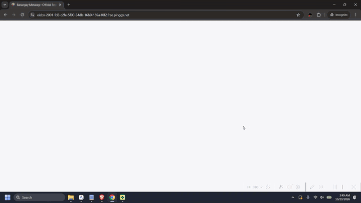

# Barangay Matatag • Smart E-Governance 3D Digital Portal

<div align="center">
  
  <h3>Republic of the Philippines • Bangsamoro Autonomous Region in Muslim Mindanao (BARMM)</h3>
  <h4>Province of Basilan • City of Lamitan • Barangay Matatag (ZIP 7302)</h4>
  <p><strong>Punong Barangay:</strong> Hon. Hulma G. Abdurahman</p>
  <p><strong>Site Developed By:</strong> <a href="https://www.zeticuz.xyz/">Sam Pangilinan (ZETICUZ)</a> · © 2026</p>
</div>

---

## 🎬 Live Demo Preview

<div align="center">
  <a href="https://github.com/ZETIC7Z/Barangay-Online-E-Governance-Portal/releases/download/v2.0.0/Barangay-Matatag-Live-Demo-1080p.mp4" title="Click to Watch Full 1080p HD Live Demo Video (03:51)">
    
  </a>
  <br />
  <p>
    <a href="https://github.com/ZETIC7Z/Barangay-Online-E-Governance-Portal/releases/download/v2.0.0/Barangay-Matatag-Live-Demo-1080p.mp4">
      
    </a>
    &nbsp;
    <a href="public/demo/live-demo-preview.mp4">
      
    </a>
  </p>
  <p><em>Full walkthrough covering the 10-second desktop intro cinema, Light/Dark mode transitions, 3D Google Satellite Map with Barangay Matatag KML boundary &amp; live GPS directions, Sangguniang Barangay roster, 3D Events carousel, Historical Archive, Resident Self-Service Portal, floating QR Certificate Printer, and Admin Command Center.</em></p>
</div>

---

## 🏛️ System Overview

The **Barangay Matatag Smart E-Governance Digital Portal** is a full-stack, real-time, web-based and multi-platform native system engineered to modernize local government operations in **Barangay Matatag, Lamitan City, Province of Basilan (BARMM 7302)**. It unifies resident self-service, 3D satellite GIS house pinpointing with live turn-by-turn navigation, automated QR-verified certificate issuance, Katarungang Pambarangay (Lupon Tagapamayapa) blotter & subpoena management, community equipment borrowing, live emergency SOS response, and dual-cloud persistence (**MongoDB Atlas** + **Google Drive Vault Sync**).

---

## ✨ Key Features & Capabilities

### 1. Resident & Public Portal
- **10-Second Edge-to-Edge Desktop Intro Cinema (`src/components/IntroSplash.tsx`)**: Plays the full-screen Barangay Matatag intro video on desktop, begins a smooth fade-to-black at `9.0s`, holds pure `#000000` black for `1.5s` after the `10.0s` video completes, and smoothly dissolves into the main portal.
- **24/7 Document Request & Zero-Login Public Tracking**:
  - Request **Barangay Clearance**, **Certificate of Indigency**, **Certificate of Residency**, **Business Permit Endorsement**, **Certificate of Good Moral Character**, and **Solo Parent Certificate**.
  - Track any request in real time without logging in using a 10-character tracking code (`MTG-XXXXXX`) or verify authenticity via the **QR Code Security Scanner**.
- **Same-Page Floating Official QR Certificate Modal (`src/components/CertificatePrinterModal.tsx`)**:
  - Displays the official Republic of the Philippines / Barangay Matatag certificate with dry-seal watermark, Punong Barangay signature (`Hon. Hulma G. Abdurahman`), and cryptographic verification QR code.
  - Includes **Download to Device** (high-resolution PNG export), **Print Document** (native OS printer selector), **Wireless Print** (Wi-Fi / AirPrint / Mopria mobile printing), and **Close**.
- **3D Google Satellite Map, Exact Barangay Boundary & Live Turn-by-Turn Directions (`src/components/SatelliteMapPinpointer.tsx`)**:
  - Uses actual **Google Satellite Hybrid View** (`mt1.google.com/vt/lyrs=y`) up to zoom level 21 with 3D perspective tilt.
  - Renders the exact 4-corner **Barangay Matatag Boundary Guide** (`BRGY_MATATAG_BOUNDARY_POLYGON`) with a clean dashed blue perimeter (`#2563EB`) and no white fill clutter.
  - **Inside-Boundary Enforcement**: Prevents users from pinpointing residences outside Barangay Matatag limits (`isPointInsideMatatagBoundary`) while auto-detecting street and Purok/Sitio names inside the boundary.
  - **Pinpoint Barangay Matatag Hall (`6.6599999° N, 122.1377029° E`)**: Clicking the Barangay Matatag Seal marker or **Live Directions** button activates **Real-Time GPS Turn-by-Turn Navigation on the Map** (showing live user position, animated road route polyline via OSRM, road distance, and driving/walking ETA) plus a direct **Open in Google Maps App** button.
- **Standalone Facebook-Style Real-Time Notification Bell (`src/components/Navbar.tsx`)**:
  - Visible in both Light Mode and Dark Mode whenever a resident or admin is signed in.
  - Streams live notifications via Socket.IO for Certificate approvals, Lupon Subpoena notices, Helpdesk chat replies, and Barangay Broadcasts—clicking any notification navigates straight to the user's portal.
- **Historical & Cultural Archive (`src/pages/PublicLanding.tsx`)**:
  - Features the **Actual History of Barangay Matatag** (from rural settlement and ancestral Yakan weaving communities to a peaceful, progressive urban barangay along the Lamitan-Isabela Highway) and the verified biography of **Datu Kalun (Pedro Javier Cuevas, 1845–1904)**, founder of Lamitan (June 1886) and inspiration for the **Lami-Lamihan Festival**.
- **3D Coverflow Community Events & Activities Carousel (`src/components/EventsCoverflowSlider.tsx`)**:
  - Continuous auto-sliding 3D perspective gallery showcasing authentic Barangay Matatag community assemblies, clean-up drives, relief distributions, and youth sports fests.

### 2. Centralized Admin Command Center (`src/pages/AdminDashboard.tsx`)
- **Executive Analytics & Revenue Ledger**: Real-time KPIs, daily/monthly clearance revenue, pending actions, and CSV export.
- **Resident RBI Registry & Account Verification**: Approve pending resident registrations, inspect uploaded Valid IDs & selfies, edit RBI profiles, or archive records.
- **Document Processing & One-Click QR Certificate Issuance**: Approve/reject applications, record Official Receipt (`OR`) payments, and open the floating QR Certificate Printer Modal.
- **Katarungang Pambarangay (Blotter & Subpoena System)**: Record disputes, schedule Lupon Tagapamayapa mediation hearings, and print official **Subpoena / Summons** notices.
- **Equipment & Facility Borrowing Manager**: Track tents, chairs, tables, sound systems, and multi-purpose hall reservations.
- **Emergency SOS & Incident Dispatch**: Live acoustic & visual alerts for resident SOS dispatches with GPS coordinates.
- **24/7 Live Helpdesk Chat & AI Assistant**: Real-time Socket.IO two-way messaging between residents and Barangay staff.
- **Dual-Cloud Persistence**: Every state change syncs to **MongoDB Atlas** (`smart_barangay_matatag`) and backs up JSON + attachments into the **Google Drive Vault** (`server/google-drive-vault/`).

---

## 💻📱 Multi-Platform Native Installers (`public/downloads/`)

Residents and Barangay staff can install the system across Desktop, Android, and iOS directly from the **Install App** button in the top navigation bar (`src/components/SmartAppDownloadModal.tsx`):

| Platform | Package / Installer | Features |
| :--- | :--- | :--- |
| **Windows 10 / 11 (x64)** | [`Barangay-Matatag-Smart-Portal-Setup.exe`](public/downloads/Barangay-Matatag-Smart-Portal-Setup.exe) | Native Windows GUI Setup Wizard with Barangay Matatag Seal icon, custom installation directory selector (`C:\Users\<User>\AppData\Local\Programs\BarangayMatatagPortal`), and automatic Desktop & Start Menu shortcut creation. |
| **macOS (Apple Silicon & Intel)** | [`Barangay-Matatag-Smart-Portal-macOS.dmg`](public/downloads/Barangay-Matatag-Smart-Portal-macOS.dmg) | Universal macOS Desktop Application bundle. |
| **Linux (Ubuntu / Debian / Fedora)** | [`Barangay-Matatag-Smart-Portal-Linux.AppImage`](public/downloads/Barangay-Matatag-Smart-Portal-Linux.AppImage) | Portable Linux Desktop AppImage. |
| **Android 8.0+** | [`Barangay-Matatag-Smart-App.apk`](public/downloads/Barangay-Matatag-Smart-App.apk) | Official signed Android package with edge-to-edge full-screen WebView and live notifications. |
| **iOS / iPadOS 15.0+** | Edge-to-Edge Standalone WebClips PWA (`manifest.webmanifest`) | Native full-screen iOS installation with Dynamic Island / Notch safe-area support and pinch-zoom lock. |

To rebuild the native desktop installers at any time:
```bash
node scripts/build-desktop-installer.mjs
```

---

## 🛡️ Defense-in-Depth Security Architecture

This system implements a multi-layered frontend and backend security architecture (`src/utils/securityShield.ts`, `server/index.ts`, and `api/index.ts`):

### 1. Client-Side Anti-Inspection & Instant YouTube Redirect (`src/utils/securityShield.ts`)
- **Right-Click & Asset Protection**: Blocks `contextmenu` (right-click) and `dragstart` across the portal to prevent unauthorized asset scraping.
- **Keyboard Shortcut Blocking**: Intercepts `F12`, `Ctrl+Shift+I`, `Ctrl+Shift+J`, `Ctrl+Shift+C`, `Ctrl+U` (View Source), and `Ctrl+S` (Save Page) on Windows/Linux and `Cmd+Option+I/J/C/U/S` on macOS.
- **Instant DevTools Redirect**: Any attempt to open browser Developer Tools via keyboard shortcut or browser menu (`outerWidth - innerWidth` / `outerHeight - innerHeight` dock detection or debugger timing trap) immediately clears the session view and redirects the browser via `window.location.replace(...)` to:
  - `https://www.youtube.com/watch?v=HI-oV3r0DOU&rco=1`

### 2. Server-Side API Hardening & Serverless Functions (`server/index.ts` & `api/index.ts`)
- **Zero Secrets in Frontend Bundle**: All database credentials (`MONGODB_URI`), administrative logic, and file vault paths reside strictly on the backend (`server/index.ts` and Vercel Serverless Function `api/index.ts`).
- **HTTP Security Headers**: Enforces `X-Content-Type-Options: nosniff`, `X-Frame-Options: SAMEORIGIN`, `X-XSS-Protection: 1; mode=block`, `Referrer-Policy: strict-origin-when-cross-origin`, and `Permissions-Policy: geolocation=(self), camera=(self), microphone=()`.
- **IP Rate Limiting**: Sliding-window rate limiter (`180 requests / minute / IP`) blocks automated scraping and brute-force attacks with HTTP `429`.
- **HTTP Referrer / Origin Domain Restriction**: Mutating API calls (`POST`, `PUT`, `PATCH`, `DELETE`) verify the request `Origin` / `Referer` header against authorized Barangay Matatag / localhost / tunnel domains.
- **Recursive NoSQL & XSS Payload Sanitization**: Strips `$` and `.` operator keys from incoming JSON bodies/queries to prevent MongoDB NoSQL injection and neutralizes inline `<script>` / `javascript:` vectors.

---

## 🔑 Default Demo & Administrative Credentials

| Role | Username / Email | Password | Portal Access |
| :--- | :--- | :--- | :--- |
| **Punong Barangay (Admin)** | `admin` (or `admin@matatag.gov.ph`) | `admin123` | Full Admin Command Center (`/admin`) |
| **Barangay Secretary (Staff)** | `secretary@matatag.gov.ph` | `staff123` | Admin Command Center |
| **Verified Resident** | `ahmad.yakan@gmail.com` | `resident123` | Resident Self-Service Portal |

---

## 🚀 Running Locally & Deploying

### Local Development (Full-Stack Vite + Express + Socket.IO + MongoDB Atlas)
```bash
npm install
npm run dev
```
- **Frontend Portal**: `http://localhost:5173`
- **Backend API & Socket.IO Server**: `http://localhost:4000`

### Production Build & Vercel Serverless Deployment
```bash
npm run build
```
- Configured via [`vercel.json`](vercel.json) and [`api/index.ts`](api/index.ts) so `/api/*` routes execute as Vercel Serverless Functions while the SPA is served with immutable asset caching.

---

## 👨‍💻 Developer Attribution

<div align="center">
  
  <p><strong>SITE DEVELOPED BY: Sam Pangilinan · © 2026</strong></p>
  <p><a href="https://www.zeticuz.xyz/">Explore Developer Portfolio &amp; Projects ↗</a></p>
</div>
